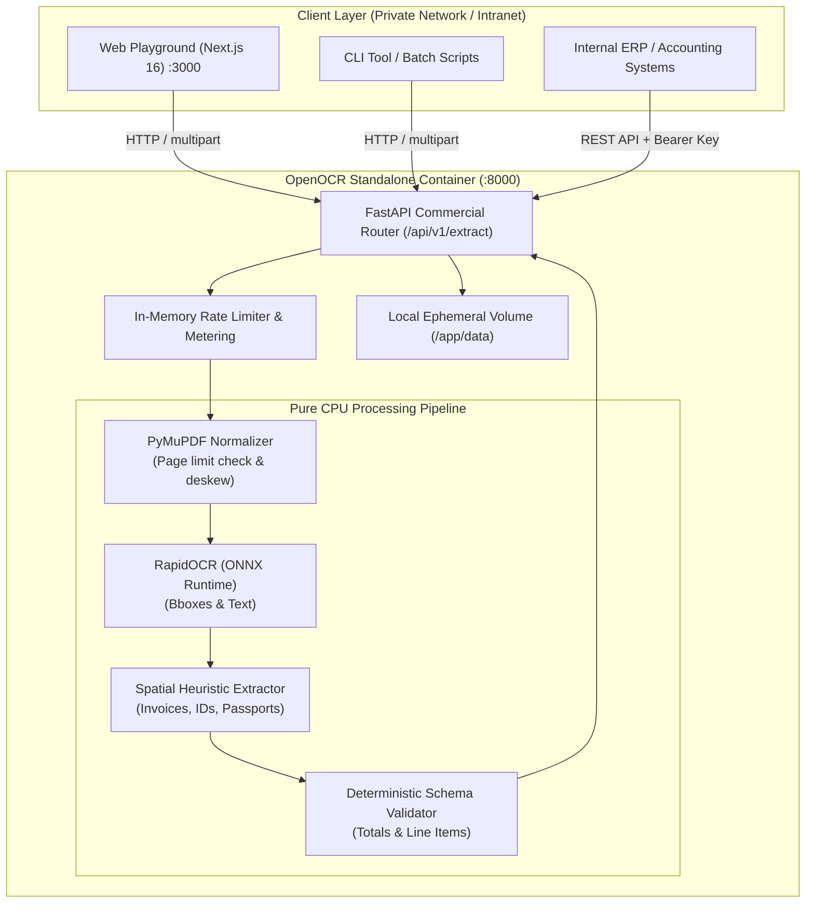

# OpenOCR Self-Hosted Infrastructure & Architecture Guide

OpenOCR is designed from the ground up to run as a **high-throughput, air-gapped, pure-CPU on-premises appliance**. It requires zero proprietary cloud AI dependencies, zero external GPUs, and transmits zero customer documents over the public internet.

---

## 1. High-Level Architecture



---

## 2. Hardware Specifications & Sizing

OpenOCR operates on optimized ONNX Runtime CPU execution providers. No NVIDIA drivers or CUDA setups are required.

| Tier | vCPUs | RAM | Disk | Throughput | Recommended Workload |
| :--- | :--- | :--- | :--- | :--- | :--- |
| **Minimum** | 2 cores | 2 GB | 10 GB SSD | ~15-20 pages / min | Dev, Testing, Low-volume office |
| **Recommended** | 4 cores | 4 GB | 25 GB SSD | ~60-80 pages / min | Mid-size accounting, continuous ingest |
| **Enterprise High-Throughput** | 8 cores | 8 GB | 50 GB NVMe | ~160-250 pages / min | Large-scale banking, ERP archiving |

---

## 3. Quickstart: One-Command Deployment

### Prerequisites
- Docker Engine 24.0+ and Docker Compose 2.20+
- Port 8000 (API) and 3000 (UI) available

### Launching Standalone Stack
```bash
# Clone the repository
git clone https://github.com/Wahla-007/ocr.git
cd ocr

# Copy environment template
cp .env.selfhosted.example .env.selfhosted

# Start the services in detached mode
docker compose -f docker-compose.selfhosted.yml up -d --build
```

Verify services are healthy:
```bash
docker compose -f docker-compose.selfhosted.yml ps
curl http://localhost:8000/api/v1/health
```

Expected output:
```json
{
  "status": "healthy",
  "engine": "rapidocr-onnxruntime-cpu",
  "mode": "self_hosted",
  "timestamp": "2026-10-23T08:45:00.000Z"
}
```

---

## 4. Air-Gapped & Privacy Guarantees

1. **Zero External Network Egress**: The container image has all ONNX model weights (`ch_PP-OCRv4_det`, `ch_PP-OCRv4_rec`) bundled directly inside. No downloads occur at runtime.
2. **Ephemeral Document Storage**: Document buffers are cleaned from disk immediately after extraction completes.
3. **Compliance Ready**: Meets strict requirements for HIPAA, GDPR, and Indian DPDP Act compliance without third-party BAA paperwork.

---

## 5. Production API Integration

### cURL Example
```bash
curl -X POST http://localhost:8000/api/v1/extract \
  -H "X-API-Key: ocr_live_pro123456789" \
  -F "file=@/path/to/invoice.pdf"
```

### Response Headers
All requests include standard RFC rate limiting and metering headers:
- `X-OpenOCR-Plan`: `pro` or `free`
- `X-OpenOCR-Items-Used`: Number of items processed on this key
- `X-OpenOCR-Items-Max`: Maximum allowed items (5 for free, unlimited for pro)
- `X-OpenOCR-Latency-Ms`: End-to-end CPU processing time
- `X-RateLimit-Limit`: Requests permitted per minute window
- `X-RateLimit-Remaining`: Remaining capacity in current window

---

## 6. Maintenance & Operational Monitoring

- **Health Check**: `GET /api/v1/health`
- **Container Logs**: `docker compose -f docker-compose.selfhosted.yml logs -f openocr-core`
- **Restarting**: `docker compose -f docker-compose.selfhosted.yml restart`
- **Graceful Shutdown**: `docker compose -f docker-compose.selfhosted.yml down`
