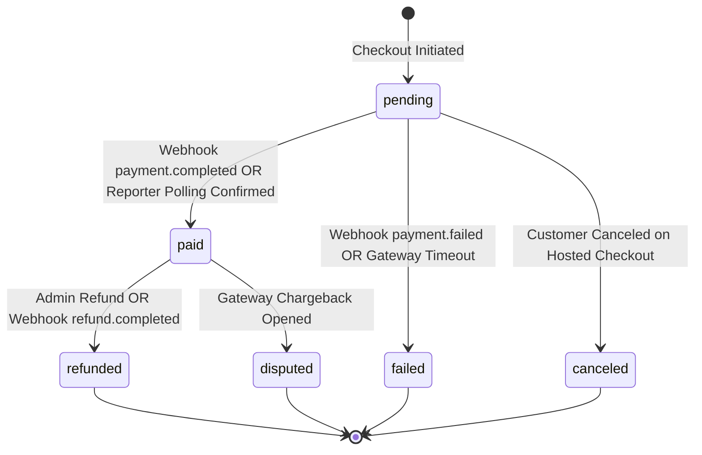
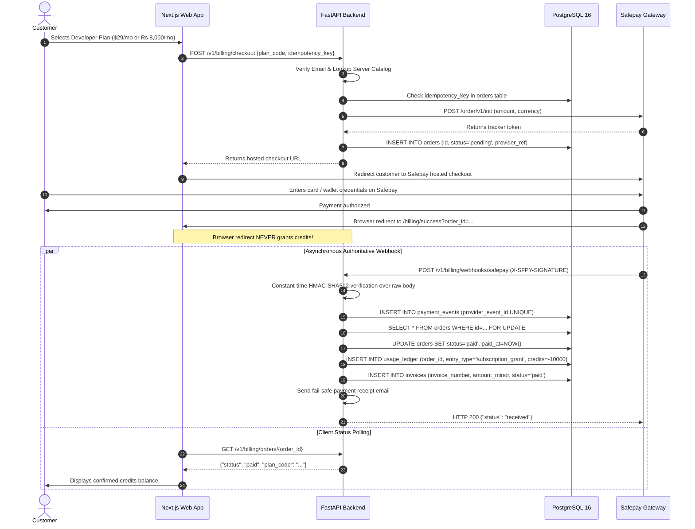

# Production-Grade Billing & Payment System (Safepay / PCI DSS SAQ-A)

## 1. System Overview & Security Principles

The OpenOCR Billing System provides production-grade credit pack purchases and monthly/annual subscriptions while adhering strictly to **OWASP ASVS Level 2** and **PCI DSS SAQ-A** standards.

### Core Security Guarantees:
- **Zero Card Data Touch (SAQ-A Scope Exclusion):** Payment card details (PAN, CVV, expiry) are entered strictly on Safepay's PCI-DSS Level 1 certified hosted checkout portal (`getsafepay.com`). No card numbers ever touch OpenOCR servers, reverse proxies, databases, memory, or log files.
- **Server-Side Catalog Integrity:** Clients only provide a catalog identifier (`plan_code`) and an idempotency key. Prices, currencies, minor units, and credit entitlements are resolved exclusively on the server from the immutable catalog. Client-side price or credit tampering is structurally impossible.
- **Strict Webhook Cryptographic Verification:** All inbound webhook events from Safepay are verified with a constant-time HMAC-SHA512 comparison over the raw request body before parsing or database mutations.
- **Idempotency & Concurrency Double-Credit Prevention:** Credit grants are protected by both row-level locks (`SELECT ... FOR UPDATE`) and database unique constraints (`uq_usage_ledger_order_entry`) on `(order_id, entry_type)`. Parallel or replayed webhook deliveries can never double-credit an account.
- **Air-Gapped / Self-Hosted Mode:** Setting `BILLING_ENABLED=false` disables all billing endpoints with HTTP 503/404, guaranteeing zero outbound network calls in private enterprise installations.

---

## 2. Architecture & Provider Abstraction

```
                            +----------------------------------------+
                            |            OpenOCR Web App             |
                            |       (/pricing, /billing, etc.)       |
                            +----------------------------------------+
                                       |                  ^
                 1. POST /v1/billing/checkout             | 3. Redirect back to
                    {plan_code, idempotency_key}          |    /billing/success
                                       |                  |    (Polling only!)
                                       v                  |
                            +--------------------+        |
                            |   OpenOCR API      |--------+
                            |  (FastAPI Backend) |
                            +--------------------+
                                |              |
        2. Order Init           |              | 4. Authoritative Inbound Webhook
        (POST /order/v1/init)   |              |    (POST /v1/billing/webhooks/safepay)
                                v              v
                      +----------------------------------+
                      |         Safepay Gateway          |
                      | (PCI DSS Level 1 Hosted Portal)  |
                      +----------------------------------+
```

### Provider Class Hierarchy
Located in [`apps/api/app/billing/providers/`](file:///d:/openocr/apps/api/app/billing/providers/):
- **`PaymentProvider` (ABC):** Abstract base defining `create_checkout_session`, `fetch_payment_status`, `verify_webhook_signature`, `parse_webhook_event`, and `create_refund`.
- **`SafepayProvider`:** Production-grade implementation for Safepay Order API (`/order/v1/init`), Reporter API (`/reporter/api/v1/payments/{tracker}`), and HMAC-SHA512 webhook verification.
- **`PayFastProvider`:** Pre-structured provider stub allowing seamless expansion to secondary gateways without altering business or ledger logic.
- **`get_payment_provider()`:** Factory function resolving provider based on `PAYMENT_PROVIDER` configuration.

---

## 3. State Machines & Event Lifecycles

### Order State Machine



### Webhook Ingestion & Fulfillment Lifecycle



---

## 4. Usage Ledger Rules & Credit Mathematics

OpenOCR implements an append-only accounting ledger in `usage_ledger` following double-entry principles (Rule 9):

### Accounting Conventions:
1. **Deductions:** When a document is processed, deductions are recorded as positive entries (`+1` credit per page extracted).
2. **Purchases / Subscription Grants:** Credit grants from paid orders are stored as negative entries (`-10,000` credits).
3. **Balance Calculation:**
   $$\text{Available Balance} = -1 \times \sum (\text{usage\_ledger.credits})$$
4. **Compensating Refund Reversals:**
   When an order is refunded, a compensating positive ledger entry (`+10,000` credits) is appended with `entry_type = "refund_reversal"`.
   - **Exhausted Credit Policy:** If credits were already spent on OCR extractions before the refund, the available balance drops negative. The API blocks subsequent extraction requests until additional credits are purchased or the dispute is resolved.

### Database Constraints for Idempotency:
```sql
ALTER TABLE usage_ledger ADD CONSTRAINT uq_usage_ledger_order_entry 
UNIQUE (order_id, entry_type);
```
Even if Safepay dispatches the same `payment.completed` event multiple times concurrently, the database constraint rejects duplicate entries with an `IntegrityError`, safely deduplicating fulfillment.

---

## 5. Catalog & Minor-Unit Currency Representation

All monetary values are strictly stored as **minor units (integers)** alongside ISO 4217 currency codes:
- **USD:** 1 dollar = 100 minor units (`$29.00` = `2900`)
- **PKR:** 1 rupee = 100 paisas (`Rs 8,000.00` = `800000`)

### Product Matrix

| Plan / Pack Code | Type | Price Minor | Currency | Credits | Description |
| :--- | :--- | :--- | :--- | :--- | :--- |
| `dev_monthly_usd` / `sub_developer_monthly_usd` | Subscription | 2900 | USD | 10,000 | Developer Platform Monthly ($29/mo) |
| `dev_annual_usd` / `sub_developer_annual_usd` | Subscription | 27600 | USD | 120,000 | Developer Platform Annual ($276/yr, save 20%) |
| `dev_monthly_pkr` / `sub_developer_monthly_pkr` | Subscription | 800000 | PKR | 10,000 | Developer Platform Monthly (Rs 8,000/mo) |
| `dev_annual_pkr` / `sub_developer_annual_pkr` | Subscription | 7680000 | PKR | 120,000 | Developer Platform Annual (Rs 76,800/yr, save 20%) |
| `pack_starter_usd` | Pack | 1000 | USD | 3,000 | Starter One-Time Pack ($10.00) |
| `pack_growth_usd` | Pack | 2500 | USD | 10,000 | Growth One-Time Pack ($25.00) |
| `pack_scale_usd` | Pack | 10000 | USD | 50,000 | Scale One-Time Pack ($100.00) |
| `pack_starter_pkr` | Pack | 280000 | PKR | 3,000 | Starter One-Time Pack (Rs 2,800) |
| `pack_growth_pkr` | Pack | 700000 | PKR | 10,000 | Growth One-Time Pack (Rs 7,000) |
| `pack_scale_pkr` | Pack | 2800000 | PKR | 50,000 | Scale One-Time Pack (Rs 28,000) |

---

## 6. Pakistan-Specific Tax & Compliance Notes

1. **Provincial Sales Tax on Electronic Services:**
   Under Pakistani provincial taxation laws (e.g., Sindh Revenue Board - SRB, Punjab Revenue Authority - PRA), electronic document intelligence and software services are subject to provincial sales tax (typically 13% to 16% where applicable).
2. **Invoice Breakdown:**
   Invoices generated in `invoices` separate `amount_minor` and `tax_minor`. Line items are serialized with currency and descriptions.
3. **Legal Disclaimer:**
   Tax rates and exemption rules must be verified with a certified Pakistani Chartered Accountant (FCA) prior to live commercial billing. OpenOCR supports configuration-driven tax adjustments.

---

## 7. Operations Runbook

### Case 1: Order Stuck in `pending` State
If a user completed payment on Safepay but closed their browser tab before redirecting, or if a webhook failed to deliver:
1. Obtain the `order_id` from the customer or from database logs.
2. The user can navigate to `/billing/success?order_id={order_id}`.
   - The backend `GET /v1/billing/orders/{order_id}` automatically polls the Safepay Reporter API (`/reporter/api/v1/payments/{tracker}`) to query authoritative gateway status.
   - If Safepay reports the order is `PAID`, `BillingService.fulfill_paid_order()` is executed on the spot, credits are granted, and status becomes `paid`.

### Case 2: Replaying a Failed Webhook Event
1. Query the `payment_events` table for entries with `status = 'failed'`:
   ```sql
   SELECT id, provider_event_id, event_type, error, received_at 
   FROM payment_events 
   WHERE status = 'failed' ORDER BY received_at DESC;
   ```
2. Replay the event using the administrative CLI or curl:
   ```bash
   curl -X POST https://api.openocr.io/v1/billing/webhooks/safepay \
     -H "Content-Type: application/json" \
     -H "X-SFPY-SIGNATURE: <calculated_hmac_sha512>" \
     -d '<raw_payload_json>'
   ```

### Case 3: Issuing an Administrative Refund
To issue a full refund and reverse ledger credits:
```bash
curl -X POST https://api.openocr.io/v1/billing/admin/refund/<order_id> \
  -H "Content-Type: application/json" \
  -H "Cookie: openocr_session=<admin_session_token>" \
  -H "X-Requested-With: OpenOCR-Web" \
  -d '{"reason": "Customer requested cancellation within 14-day window"}'
```
This endpoint:
- Verifies order is currently `paid`.
- Submits refund request to Safepay gateway.
- Sets `orders.status = 'refunded'`.
- Appends compensating `usage_ledger` reversal (`+credits`).
- Marks invoice status as `refunded`.

### Case 4: Rotating Safepay Webhook Secret
1. Generate new webhook secret in Safepay Merchant Dashboard.
2. Update `SAFEPAY_WEBHOOK_SECRET` in environment variables or Secret Manager.
3. Perform a zero-downtime rolling restart of `apps/api`.
4. Trigger a test webhook in Safepay Sandbox/Live to confirm HTTP 200 response.

---

## 8. Go-Live Checklist

- [ ] **1. Safepay Production Account Approved:** Complete KYC verification with Safepay for Pakistani merchant account settlement.
- [ ] **2. Production API Keys:** Set `SAFEPAY_ENV=production`, `SAFEPAY_API_KEY=sec_live_...`, `SAFEPAY_V1_SECRET=...`.
- [ ] **3. Webhook Endpoint Registered:** Register `https://api.yourdomain.com/v1/billing/webhooks/safepay` in the Safepay Dashboard.
- [ ] **4. Webhook Secret Configured:** Set `SAFEPAY_WEBHOOK_SECRET` to match the secret displayed in Safepay dashboard.
- [ ] **5. HTTPS & TLS 1.3 Enforced:** Verify all ingress traffic forces HTTPS with secure HSTS headers.
- [ ] **6. Email SPF / DKIM / DMARC:** Ensure transactional email domain is authenticated so receipts and alerts are not flagged as spam.
- [ ] **7. Live Real-Money Smoke Test:**
  - Execute a live purchase of the Starter Pack ($10 or Rs 2,800).
  - Confirm instant webhook arrival and credit addition to usage ledger.
  - Test download of generated PDF/HTML invoice.
  - Issue test refund via Safepay dashboard and verify compensating ledger entry.
- [ ] **8. Provincial Sales Tax Sign-Off:** Review applicable sales tax rates with financial auditor.
- [ ] **9. Alerting Active:** Set up Sentry and Datadog/CloudWatch monitors on `openocr.billing.safepay` and `payment_events.status == 'failed'`.
